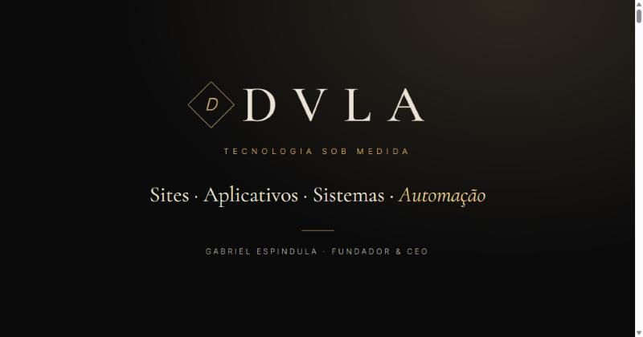

# DVLA — Tecnologia sob medida

**Sites · Aplicativos · Sistemas · Automação**

🔗 **[g-espindula97.github.io](https://g-espindula97.github.io)**

---

Site institucional da **DVLA**, empresa de desenvolvimento fundada por **Gabriel Espindula**.
Projetos digitais sob medida — do briefing ao servidor no ar — com design autoral, código bem construído e atendimento direto com o fundador.

## O que a DVLA faz

| Serviço | Para quê |
|---|---|
| **Sites institucionais** | Presença digital premium, rápida e otimizada para o Google |
| **Landing pages** | Páginas de alta conversão para campanhas e captação |
| **E-commerce** | Lojas com Pix, cartão, boleto, frete e painel administrativo |
| **Aplicativos mobile** | iOS e Android com uma única base de código |
| **Sistemas web & SaaS** | Painéis, áreas de cliente, relatórios e APIs |
| **Automação & IA** | Integrações, robôs de rotina e assistentes inteligentes |

## Projetos em destaque

- **[Portal B2B WD Ferragens](https://github.com/G-Espindula97/portal-wd-ferragens-vitrine)** — plataforma de pedidos com tabela de preços por cliente, PDF, WhatsApp e painel administrativo.
- **[Build Lab](https://g-espindula97.github.io/the-isle-build-lab/)** — planejador de builds para The Isle: Evrima, em um único arquivo HTML.

## Contratação

Dois modelos, definidos no orçamento: **compra do projeto** (pagamento único) ou **plano mensal** (hospedagem, domínio, manutenção e suporte inclusos).

## Contato

- 💬 WhatsApp: [(35) 99933-7591](https://wa.me/5535999337591)
- ✉️ E-mail: [gabrielfernando.espindula@gmail.com](mailto:gabrielfernando.espindula@gmail.com)

---

Esta é a versão publicada (compilada) do site. O código-fonte é mantido em repositório privado. © DVLA · Fundada por Gabriel Espindula.
